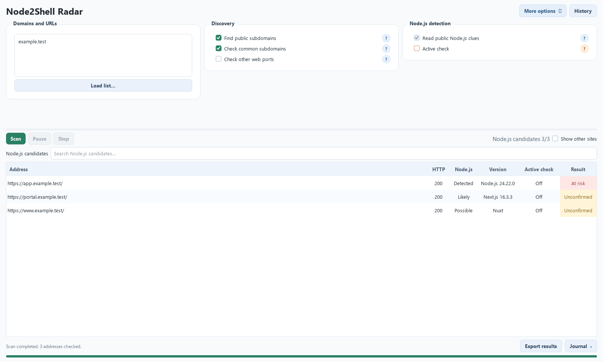

<div align="center">
  
  <h1>Node2Shell Radar</h1>
  <p>Find your Node.js websites. See which ones need attention.</p>
  <p><a href="https://github.com/Secragon/node2shell-radar/releases/latest">Download for Windows or Linux</a></p>
</div>

Node2Shell Radar is a desktop **Node2Shell Scanner** for discovering websites that may use Node.js and reviewing their exposure to **CVE-2026-111497**. Enter a domain or URL, run a scan, and review the evidence in one place. The standard scan looks for websites and reads public responses; the optional active check is off until you select it.



*Illustrative interface preview using example data. It is not a scan of a real organization.*

## Download and run

| Platform | Download | Run |
| --- | --- | --- |
| Windows 10/11, x64 | [`Node2Shell-Radar-windows-x64.exe`](https://github.com/Secragon/node2shell-radar/releases/latest) | Double-click the single EXE. No installer or Python needed. |
| Linux, x64 | [`Node2Shell-Radar-linux-x86_64.tar.gz`](https://github.com/Secragon/node2shell-radar/releases/latest) | Extract the archive, then run `./Node2Shell-Radar` in a desktop session. No Python needed. |

Each [release](https://github.com/Secragon/node2shell-radar/releases/latest) includes `SHA256SUMS` for checking the downloads. Linux needs standard desktop graphics libraries. Sessions are saved on your machine; you choose where to save exports.

## What happens during a scan

1. **Enter a domain or URL.** A domain checks its normal web ports. A full URL checks the address you entered.
2. **Find websites.** Public subdomain sources, common DNS names and TLS certificate names help find more sites. A name counts as a reached website only after a web response is received. Extra ports and deeper discovery are optional.
3. **Recognize Node.js clues.** Radar looks at public response headers, cookies and pages. It can identify Node.js directly or find frameworks such as Next.js and Nuxt that make a site worth reviewing. A framework alone does not prove that the public site runs on Node.js.
4. **Review the result.** The table shows the website, its Node.js signal, any reported version and the assessment. Double-click a row for the evidence and its limits. Related addresses can expand beneath one website; click an address to copy it.
5. **Filter and export.** Search the results or reveal other reached websites. **Export results** saves the rows currently visible as JSON or CSV. The **Journal** shows scan activity separately.

| Result | What it means |
| --- | --- |
| **Fixed version** | The site reports a Node.js version with the upstream fix. Its actual decoder build is not verified remotely. |
| **At risk** | The site reports an older Node.js version. A vendor-provided fix may still be present. |
| **Unconfirmed** | Radar cannot establish the Node.js version or patch state from the available evidence. |

**Active check** sends a small number of additional requests to candidate sites when you select it. It reports whether Brotli request parsing appears reachable on the tested paths; it cannot prove a server is vulnerable, patched or exploitable. The check is off by default. Passive signals can also be hidden or changed by proxies, so no result is a complete inventory or a guarantee of safety.

## Build from source

Python 3.11+ is required. On Windows:

```powershell
py -3.11 -m venv .venv
.venv\Scripts\python.exe -m pip install -e ".[build]"
.venv\Scripts\pythonw.exe -m radar
```

On Linux:

```sh
python3 -m venv .venv
.venv/bin/python -m pip install -e '.[build]'
.venv/bin/python -m radar
```

Run the offline tests with `python -m unittest discover -s tests -v`. Platform packages can be built with `scripts/build_windows.py` or `scripts/build_linux.py`. Tagged versions build both packages in [GitHub Actions](.github/workflows/release.yml).

## Privacy and responsible use

Scan only sites you own or are authorized to assess. Sessions and exports stay on your machine; Radar does not upload results to Secragon. Discovery may contact public services, and active checks send requests to target sites. Saved sessions can contain hostnames and URLs, so avoid putting secrets in URL queries.

Website discovery techniques were adapted from [PHP2Shell Radar](https://github.com/Secragon/php2shell-radar). For a suspected issue in this tool, see [SECURITY.md](SECURITY.md).

Licensed under [Apache 2.0](LICENSE). Copyright © 2026 Secragon.
