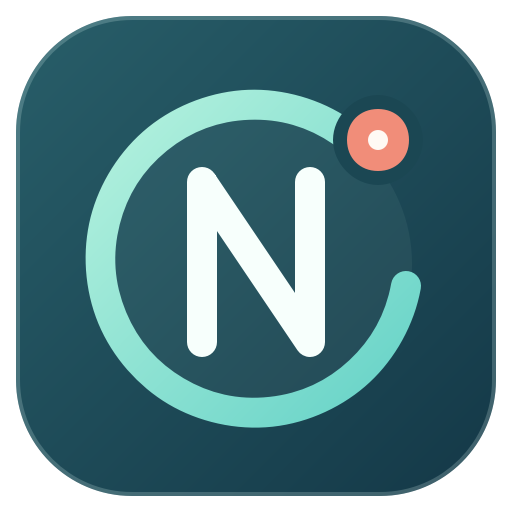

<div align="center">
  
  <h1>Node2Shell Radar</h1>
  <p>Find Node.js websites. Identify deployed runtimes that need the Brotli fix.</p>
</div>

Node2Shell Radar is a desktop asset-discovery and exposure-triage tool for **CVE-2026-111497**. Enter domains or URLs to discover reachable websites and inspect public Node.js clues.

The desktop layout follows PHP2Shell Radar's three-column workflow: targets,
discovery, and detection, followed by the results table and journal. **More
options** exposes editable DNS names, deeper DNS checks, certificate names,
site crawling, per-IP checks, TLS verification, concurrency, timeout, and
request interval.
Additional web ports can be edited on the main screen.
The active-check control is visible but unavailable until a Node.js-specific
Brotli probe has been validated; it does not send traffic or affect verdicts.

## What a scan does

1. **Find websites.** Public subdomain sources, common DNS names and TLS certificate names are enabled at launch. Each name is resolved and checked over HTTP or HTTPS before it counts as reached. Extra ports, per-IP checks and bounded site crawling are separate options.
2. **Recognize Node.js clues.** A direct Node.js response header is stronger evidence than an Express or Koa header. HTML and response-header markers identify Next.js, Nuxt, Remix and SvelteKit candidates; their pages may be static or use another runtime, so framework evidence alone does not confirm a running Node.js service. A reported framework version is shown separately from the Node.js runtime version.
3. **Assess version evidence.** A Node.js version reported over HTTP is compared with the upstream security releases. Missing, conflicting or vendor-specific versions stay unconfirmed.
4. **Review the rest.** After completion, *Show other websites* reveals reached sites without Node.js runtime evidence. Checked addresses and evidence remain in the saved session; JSON/CSV export contains the currently visible result rows.

Results group paths and equivalent HTTP/HTTPS, apex/`www`, or host aliases under
one website. HTTP upgrades display the HTTPS destination; separate direct
views appear in a dropdown only when their public pages agree. Shared wildcard
DNS pages, weak error pages, empty HTTP 200 responses, and redirects outside
the entered domain scope stay in the journal instead of inflating the site
count. Wildcard pages that only echo the requested hostname are recognized as
the same page; identical HTTP/HTTPS 401 or 403 views group into one site.
Unresolved DNS candidates and each checked crawl page remain separate assets
in the saved session, while reached pages of one site share a result row.
Requests use a browser-compatible User-Agent that identifies
Node2Shell Radar. Public data sources can rate-limit discovery, so the scan
cannot guarantee every subdomain was found.

| Result | Meaning |
| --- | --- |
| **Fixed version reported** | An HTTP response reports an upstream fixed version; confirm that the actual process uses it. |
| **At risk** | The reported version predates the upstream fix. |
| **Unconfirmed** | The version is missing, conflicting, vendor-specific, or not tied to a confirmed Node.js runtime. |

The upstream fixed releases are **Node.js 22.23.4, 24.22.1 and 26.12.1**. The vulnerable component is the Brotli **decoder**. Serving a Brotli-compressed response does not prove the server accepts or decompresses Brotli request bodies. A site may also be exposed through outbound responses that its Node.js process fetches. Some distribution builds use a system Brotli library, so a fixed Node.js version string alone is not full patch verification. Radar does not send malformed Brotli streams or claim remote code-execution confirmation. [Node.js advisory](https://nodejs.org/en/blog/vulnerability/october-2026-security-releases), [Imperva's validation](https://www.imperva.com/blog/node2shell-from-brotli-data-to-remote-code-execution/), [Express Brotli request parsing](https://expressjs.com/en/guide/migrating-5/), [Debian's system-library note](https://security-tracker.debian.org/tracker/CVE-2026-111497).

## Run from source

Python 3.11+ is required for development. On Windows:

```powershell
py -3.11 -m venv .venv
.venv\Scripts\python -m pip install -e .
.venv\Scripts\pythonw -m radar
```

On Linux:

```bash
python3 -m venv .venv
.venv/bin/python -m pip install -e .
.venv/bin/python -m radar
```

The CLI uses the same engine and can export JSON or CSV:

```bash
python -m radar --cli example.com --no-active-dns --output report.json
python -m radar --cli app.example.com --output report.csv
```

Build a single-file Windows GUI executable with `scripts/build_windows.py` on Windows, or a portable Linux archive with `scripts/build_linux.py` on Linux. Each writes to one `release/` directory. Builds are platform-specific; PyInstaller does not cross-compile. `scripts/write_checksums.py release` writes SHA-256 sums once both platform packages are present.

Node2Shell Radar is released under [Apache-2.0](LICENSE).
